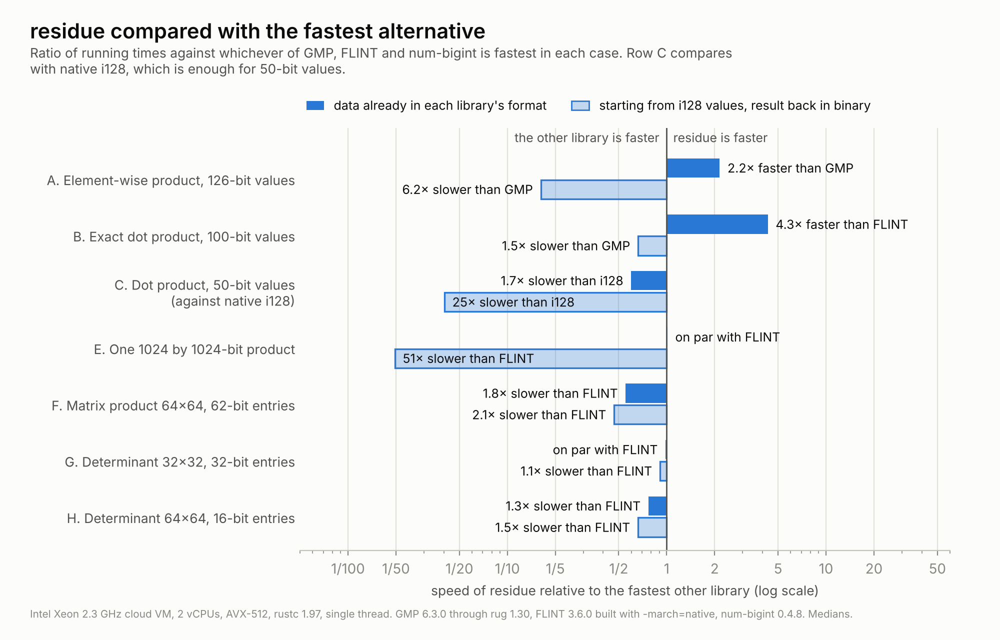
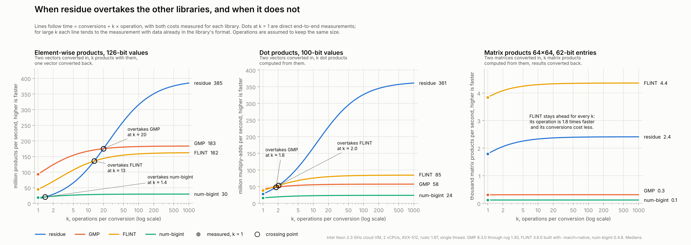

# residue-rs

[](https://crates.io/crates/residue-rs)
[](https://docs.rs/residue-rs)
[](https://github.com/supportlibrariesp4droid/residue-rs/actions/workflows/ci.yml)
[](LICENSE)
[](#cargo-features)
[](https://github.com/rust-secure-code/safety-dance/)


Exact integer arithmetic in a Residue Number System (RNS) for Rust. The library
runs on the CPU, uses SIMD where it helps, works without the standard library,
and contains no `unsafe` code.

In a Residue Number System an integer is stored as its remainders modulo a set
of primes. Addition, subtraction and multiplication then work on each remainder
separately: no carry has to travel from one word to the next, so all the
remainders can be computed at once. residue-rs builds exact signed integers on
this idea. Overflow is always detected, sign and comparison are exact, and
division is available, all without converting back to binary first.

The approach has a clear strength and a clear weakness, and the benchmarks
below show both. Arithmetic on data that stays in RNS is fast: an exact dot
product of 100-bit integers runs 4 times faster than with FLINT and 6 times
faster than with GMP.
Converting into and out of RNS is slow, so a single operation on binary inputs
is much faster with GMP. On matrix products and determinants residue is several
times faster than GMP, but FLINT, which uses the same multi-modular idea in C,
is as fast or faster.

## Example

```rust
use residue::{rns_base, Extender, Rns, RnsMatrix, RnsVec};

// A base of 4 primes below 2^31 holds integers up to 2^122 in absolute value.
rns_base!(Narrow: largest 4);
// 9 primes allow up to 2^277.
rns_base!(Wide: largest 9);

let a: Rns<Narrow, 4> = "-123456789012345678901234567890".parse().unwrap();
let b = Rns::<Narrow, 4>::from_i64(42).unwrap();
assert!(a < b); // exact comparison, without converting to binary
let c = a * b; // panics on overflow; checked_mul returns None instead

// When a result needs more room, move to a wider base without converting.
let ext = Extender::<Narrow, 4, Wide, 9>::new();
let big = ext.extend(&a).unwrap() * ext.extend(&a).unwrap();

// Many integers at once, processed with SIMD.
let xs = RnsVec::<Wide, 9>::from_i128s(&[1, -2, 3]).unwrap();
let ys = RnsVec::<Wide, 9>::from_i128s(&[4, 5, -6]).unwrap();
assert_eq!(xs.dot(&ys).unwrap().to_i128(), Some(1 * 4 - 2 * 5 - 3 * 6));

// Exact matrices: products and determinants.
let m = RnsMatrix::<Wide, 9>::from_i128s(2, 2, &[3, 1, 4, 1]).unwrap();
assert_eq!(m.determinant().unwrap().to_i128(), Some(-1));
let m2 = &m * &m;

// Division: exact when the divisor divides, or general with a remainder.
let x = Rns::<Wide, 9>::from_i64(91).unwrap();
let y = Rns::<Wide, 9>::from_i64(7).unwrap();
assert_eq!(x.div_exact(y).unwrap().to_i128(), Some(13));
assert_eq!((x % Rns::from_i64(10).unwrap()).to_i128(), Some(1));
```

## When to use it

One rule decides almost everything. With `n` primes in the base, an addition or
a multiplication inside RNS costs `O(n)` independent word operations, while
converting a number into RNS or back to binary costs `O(n²)`. RNS pays off when
a computation performs many operations for each conversion.

Linear algebra fits this rule well, because every entry of a matrix takes part
in many products: matrix products, determinants and long dot products are where
the library is strongest. Element-wise work on large arrays also benefits, as
long as the data stays in RNS for several operations.

It is the wrong tool in three situations. Values that fit in `i64` or `i128`
are faster with native integers. A computation that converts its inputs, does
one operation and converts the result back is faster with GMP. A single
multiplication of numbers with many thousands of bits is also better done by
GMP, whose algorithms for very large numbers this library does not try to
match. General division leaves RNS as well, so code that divides often loses
much of the advantage.

If you can link a C library and want the fastest exact matrix products and
determinants, use [FLINT](https://flintlib.org). In the measurements below it
is 1.3 to 2.1 times faster than residue on the matrix product and the 64×64
determinant, about as fast on the 32×32 determinant, and it does far more. The
reasons to choose residue are different. It is pure Rust with no `unsafe` code,
so there is no C toolchain to set up and no LGPL library to link. It works
without the standard library. Its bases are checked at compile time and its
integers refuse to overflow instead of wrapping. And it lets you keep data in
RNS across many operations, which is where it is fastest of all.

## Benchmarks

<picture>
  <source media="(prefers-color-scheme: dark)" srcset="docs/speedup-dark.png">
  
</picture>

Each scenario is measured in two ways. In the first, the data is already in each
library's own representation. In the second, every library starts from `i128`
values and returns the result in binary, so each one also pays for its own
conversions. The chart compares residue with whichever other library is fastest
in each case. GMP gets its best case in both measurements: preallocated values,
in-place assignment, and the fused `addmul` and `submul` operations. FLINT runs
its own default algorithms.

Element-wise products and dot products (rows A and B) are faster with residue
only while the data stays in RNS: 2.2 times faster than GMP on the element-wise
product and 4.3 times faster than FLINT on the dot product. Starting from
`i128`, the conversions cost more than the arithmetic and GMP wins, by 6.2 times
on the element-wise product. For 50-bit values (row C) native `i128` arithmetic
is faster than anything else. A single 1024-bit product (row E) takes 118 ns in
residue, 120 ns in FLINT and 144 ns in GMP when the operands are already in each
library's format, but converting them in and out makes residue 51 times slower
than FLINT.

On matrix products and determinants (rows F, G and H) residue is 2.8 to 7.7
times faster than GMP, which here runs textbook algorithms, but FLINT is faster
than residue. FLINT is 1.8 times faster on the matrix product (2.1 starting from
`i128`) and 1.3 times faster on the 64×64 determinant (1.5 from `i128`). On the
32×32 determinant the two are level.

<picture>
  <source media="(prefers-color-scheme: dark)" srcset="docs/benchmarks-dark.png">
  
</picture>

The same results as absolute times. Each cell gives the time with data already
in the library's format, then the time starting from `i128`.

| Scenario | residue | GMP | FLINT | num-bigint |
|---|---:|---:|---:|---:|
| A. Element-wise product, 126-bit (ns per element) | 2.5 / 66.0 | 5.4 / 10.7 | 6.2 / 22.2 | 33.7 / 54.3 |
| B. Exact dot product, 100-bit (ns per element) | 2.7 / 35.2 | 17.3 / 23.3 | 11.8 / 25.7 | 41.5 / 60.7 |
| C. Dot product, 50-bit (ns per element; native `i128`: 0.8) | 1.3 / 19.9 | | | |
| E. One 1024 by 1024-bit product (ns) | 118 / 6814 | 144 / 170 | 120 / 134 | |
| F. Matrix product 64×64, 62-bit entries (ms) | 0.41 / 0.56 | 3.19 / 3.23 | 0.23 / 0.26 | 8.45 / 8.44 |
| G. Determinant 32×32, 32-bit entries (ms) | 0.42 / 0.46 | 1.31 / 1.32 | 0.41 / 0.42 | 3.15 / 3.05 |
| H. Determinant 64×64, 16-bit entries (ms) | 1.86 / 2.11 | 9.84 / 9.52 | 1.43 / 1.40 | 23.5 / 23.7 |

Converting `i128` values into a base of 9 primes costs 16.4 ns per element, and
converting a 9-prime value back to binary costs 28.8 ns. These two numbers
explain rows A and B: an element-wise product costs 2.5 ns in RNS, but bringing
two inputs in and one result out costs about 62 ns. The conversion back to
binary is not yet vectorized, and is the most obvious place to improve.

<picture>
  <source media="(prefers-color-scheme: dark)" srcset="docs/crossover-dark.png">
  
</picture>

The chart above follows from the same measurements. If a program converts its
data once and then performs k operations with it, the time is the conversion
cost plus k times the cost of one operation, and each line shows the resulting
speed for one library. residue starts slow and gets faster as k grows. On
element-wise products it overtakes FLINT at about 13 operations per conversion
and GMP at about 20; on dot products it overtakes both at about 2. On matrix
products it never overtakes FLINT, which is faster both at the operation and at
the conversion. The model assumes that the operations keep the same size, which
a chain of products of growing numbers would not.

The measurements were taken on an Intel Xeon at 2.3 GHz in a cloud virtual
machine with 2 vCPUs and AVX-512, on a single thread, with rustc 1.97, GMP
6.3.0 through `rug` 1.30, FLINT 3.6.0 built from source with `-march=native`,
and `num-bigint` 0.4.8. All figures are medians from one session, with 4096
elements per vector. A shared virtual machine adds noise of about 10 to 20
percent between runs, and on another processor model of the same cloud the
matrix product of residue took 0.33 ms instead of 0.41 ms, so the ratios matter
more than the absolute times. For determinants, GMP and `num-bigint` run
fraction-free Bareiss elimination and FLINT runs its default `fmpz_mat_det`;
all the results are checked to be equal. Every input passes through
`black_box`, so the compiler cannot move work out of the timed loop.

FLINT is written in C and cannot be timed by criterion, so
[benches/flint/bench.c](benches/flint/bench.c) times it with the same method:
warm-up, then the median of 20 samples. It regenerates the same inputs with the
same random generator and prints a check value for each scenario, which matches
the one residue computes. To reproduce the measurements and the charts:

```sh
cargo bench --bench compare            # builds GMP from source once, about 4 minutes
cc -O3 -march=native benches/flint/bench.c -lflint -lgmp -o target/flint-bench
target/flint-bench target/criterion    # optional, needs FLINT 3 installed
python3 scripts/plot_benchmarks.py     # reads target/criterion, writes docs/
```

## How it works

The moduli are distinct primes below `2^31`, so each remainder fits in a `u32`
and the spare bit makes modular addition branchless. Multiplication uses
Montgomery form, so no channel ever divides at runtime. A base is declared with
the `rns_base!` macro, which checks the primes and computes every constant at
compile time; a composite or repeated modulus is a compile error.

The `Rns` type keeps one more channel, the value modulo `2^64`, maintained with
ordinary wrapping arithmetic. This extra channel makes the overflow coefficient
of the Chinese Remainder Theorem exactly computable, following Shenoy and
Kumaresan, and that in turn gives exact reconstruction, exact base extension
and an exact sign test. Every value also carries a certified bound on its size,
and any operation that could leave the range of the base is refused instead of
wrapping.

`RnsVec` stores many integers channel by channel, so each channel is a
contiguous array with a single modulus, which is the layout SIMD needs. With the
`std` feature its kernels run with AVX2 or AVX-512, chosen at runtime through
the `pulp` crate. `RnsMatrix` builds on the same layout. Its matrix product
accumulates raw products and reduces each output entry once. Its determinant
runs Gaussian elimination separately modulo each prime and combines the results
with the Chinese Remainder Theorem, after Hadamard's inequality has confirmed
that the determinant fits.

[DESIGN.md](DESIGN.md) explains the mathematics in detail, including the proofs
behind exact division and the three tiers of the sign test.

## Cargo features

| Feature | Default | What it adds |
|---|---|---|
| `std` | yes | runtime selection of AVX2 or AVX-512 kernels; implies `alloc` |
| `alloc` | no | `RnsVec` and `RnsMatrix`, still without the standard library |
| `num-bigint` | no | conversions to and from `num_bigint::BigInt` and `BigUint` |

Without any feature the crate is `no_std` and needs no allocator.

## Testing

Every operation is checked against `num-bigint` with property tests, on bases
of 1 to 16 primes. These include a base of very small primes and a base that
mixes large and small ones, because they reach code paths that bases of large
primes never touch. Generated values have a bit length chosen at random, so
small, medium and nearly full-range values all appear. Rare branches have
dedicated tests: each of the three sign tiers, the correction step of Knuth's
division algorithm, determinants divisible by a prime of the base, and long dot
products of maximal residues. The SIMD build, the scalar build and a debug build
with overflow checks all run the same 280 tests.

```sh
cargo test --release --all-features
cargo test --release --no-default-features --features alloc   # scalar kernels
cargo test --all-features                                     # debug, overflow checks on
```

## Status

The library is at version 0.1 and its API may still change. It currently
provides the single-prime arithmetic, bases checked at compile time, the
modular type `RnsMod`, exact signed integers with sign, comparison, division and
base extension, SIMD vectors with dot products, and exact matrices with
products and determinants. The next planned step is arithmetic modulo a large
odd number with RNS Montgomery multiplication, which is the usual use of RNS in
cryptography. On speed, the main open question is whether primes of about 62
bits, as FLINT uses, would close the gap on matrices by halving the number of
channels. Python bindings, multithreading across primes, and a vectorized
conversion back to binary are further candidates.

## License

Copyright 2026 Pietro Maria Piazza.

Licensed under the Apache License, Version 2.0. See [LICENSE](LICENSE) and
[NOTICE](NOTICE).

The benchmarks use GMP through the `rug` crate, and a separate C program uses
FLINT. Both are licensed under the LGPL and are used only for benchmarking:
they are not part of the library and are not linked into programs that depend
on residue-rs.
